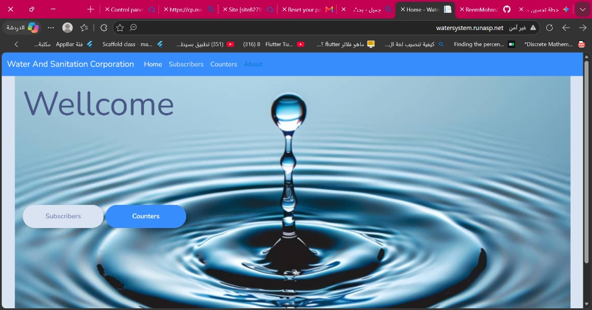
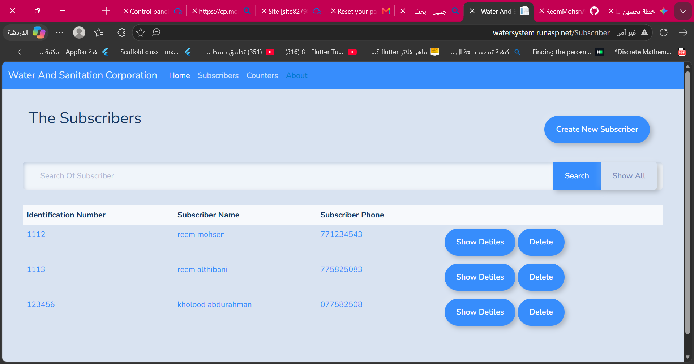
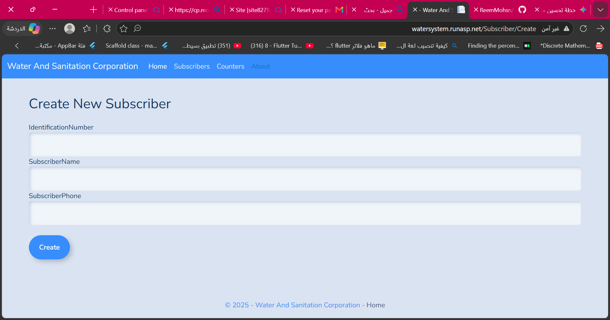
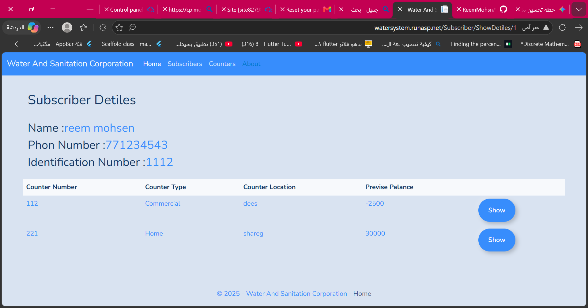
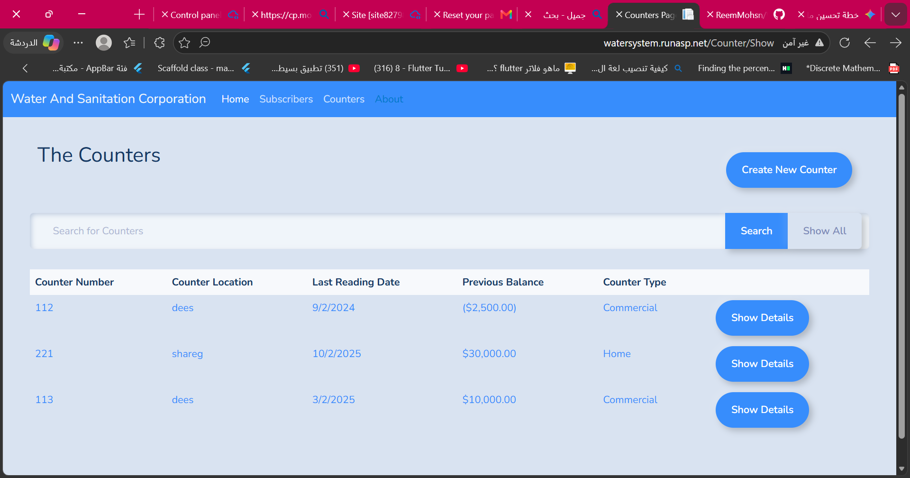
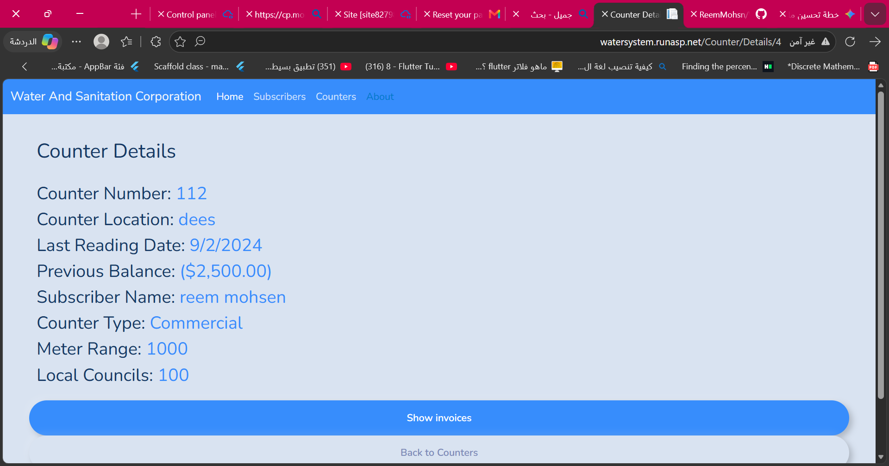
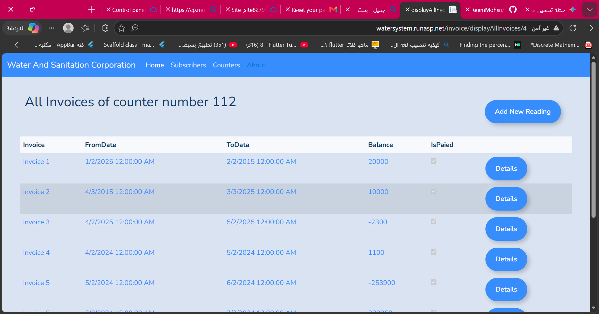
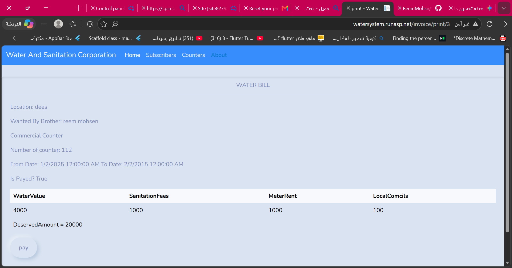
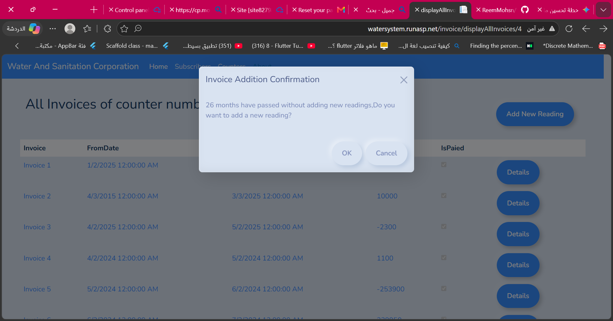
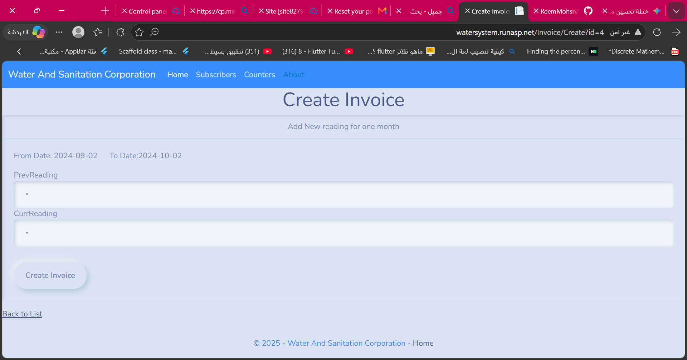

<h1 align="center">💧 Water & Sanitation Corporation — Management System</h1>

<p align="center">
  An <b>ASP.NET Core MVC</b> web application for managing subscribers, water meters (counters), monthly readings, and automated water billing — powered by advanced <b>SQL Server</b> database programming.
</p>

<p align="center">
  
  
  
  
</p>

<p align="center">
  <a href="#about">About</a> ·
  <a href="#features">Features</a> ·
  <a href="#screenshots">Screenshots</a> ·
  <a href="#live-demo">Live Demo</a> ·
  <a href="#tech-stack">Tech Stack</a> ·
  <a href="#getting-started">Getting Started</a>
</p>

---

<a id="about"></a>
## 💧 About the Project

The **Water & Sanitation Corporation Management System** is a database-driven web application built with **ASP.NET Core MVC** and **SQL Server**. It digitizes core utility operations—managing subscribers, linking multiple **Home** and **Commercial** water counters per subscriber, recording monthly meter readings, generating itemized water bills, and tracking payments.

A core architectural highlight of this project is its reliance on **advanced database programming**, delegating critical calculations, validations, and data integrity rules directly to **Stored Procedures**, **Views**, **User-Defined Functions**, and **Triggers** inside SQL Server.

<a id="features"></a>
## ✨ Key Features

- 👥 **Subscribers Management** — Register new subscribers (ID number, full name, phone), search/filter subscribers, delete records, and inspect each subscriber's linked water counters and balances.
- 📟 **Water Counters (Meters) Management** — Manage **Home** and **Commercial** meters with counter number, location, last reading date, previous balance, meter rent range, and local council fees, with search and detail views.
- 🧾 **Automated Monthly Billing & Readings** — Add new monthly meter readings (`Previous Reading` & `Current Reading`) to automatically calculate billing amounts and update counter balances.
- ⏰ **Overdue Reading Detection** — Automatically detects elapsed months without new meter readings (e.g., alerting staff before creating a new reading) to maintain continuous billing records.
- 🖨️ **Itemized Water Bill & Payment Tracking** — Displays printable water bills breaking down **Water Value**, **Sanitation Fees**, **Meter Rent**, **Local Councils**, and total **Deserved Amount**, along with paid/unpaid status tracking and payment confirmation.
- ⚙️ **Advanced SQL Server Logic** — Implements business workflows and automated balance updates using **Stored Procedures**, **Views**, **Functions**, and **Triggers**.

<a id="screenshots"></a>
## 🖥️ Screenshots

A walkthrough of the system's main screens:

<table>
  <tr>
    <td align="center" width="50%">
      <a href="screenshots/home.jpg"></a>
      <br /><b>Home Page</b>
    </td>
    <td align="center" width="50%">
      <a href="screenshots/subscribers_list.png"></a>
      <br /><b>Subscribers List & Search</b>
    </td>
  </tr>
  <tr>
    <td align="center" width="50%">
      <a href="screenshots/create_subscriber.png"></a>
      <br /><b>Create New Subscriber</b>
    </td>
    <td align="center" width="50%">
      <a href="screenshots/subscriber_details.png"></a>
      <br /><b>Subscriber Details & Linked Counters</b>
    </td>
  </tr>
  <tr>
    <td align="center" width="50%">
      <a href="screenshots/counters_list.png"></a>
      <br /><b>Water Counters List</b>
    </td>
    <td align="center" width="50%">
      <a href="screenshots/counter_details.png"></a>
      <br /><b>Counter Details</b>
    </td>
  </tr>
  <tr>
    <td align="center" width="50%">
      <a href="screenshots/invoices_list.png"></a>
      <br /><b>Counter Invoices History</b>
    </td>
    <td align="center" width="50%">
      <a href="screenshots/water_bill.png"></a>
      <br /><b>Itemized Water Bill & Payment</b>
    </td>
  </tr>
  <tr>
    <td align="center" width="50%">
      <a href="screenshots/overdue_reading_alert.png"></a>
      <br /><b>Overdue Reading Alert</b>
    </td>
    <td align="center" width="50%">
      <a href="screenshots/create_invoice.png"></a>
      <br /><b>Create Invoice (Add Monthly Reading)</b>
    </td>
  </tr>
</table>

<a id="live-demo"></a>
## 🌐 Live Demo

The deployed web application is accessible at:
- **Live Website:** [watersystem.runasp.net](http://watersystem.runasp.net)

<a id="tech-stack"></a>
## 🛠️ Tech Stack

| Purpose | Technology |
| :--- | :--- |
| **Back-End & Architecture** | ASP.NET Core MVC, C# |
| **Front-End** | Razor Views, HTML, CSS, JavaScript |
| **Database & Business Logic** | Microsoft SQL Server (Stored Procedures, Views, Functions, Triggers) |
| **Hosting** | MonsterASP.NET (`runasp.net`) |

<a id="getting-started"></a>
## 🚀 Getting Started

### Prerequisites

- **.NET SDK** (matching the project's target framework in the `.csproj` file)
- **Visual Studio 2022** (or VS Code with C# Dev Kit)
- **Microsoft SQL Server** (LocalDB or SQL Server Express)

### Run Locally

```bash
git clone [https://github.com/ReemMohsn/Water-Sanitation-DB-System.git](https://github.com/ReemMohsn/Water-Sanitation-DB-System.git)
cd Water-Sanitation-DB-System
dotnet restore
```

1. Restore the SQL Server database backup or execute the database scripts (tables, views, functions, stored procedures, and triggers).
2. Update the connection string in `appsettings.json` to point to your local SQL Server instance.
3. Run the application with `dotnet run` or press **F5** in Visual Studio.

## 👩‍💻 Author

- **[Reem Mohsen](https://github.com/ReemMohsn)**
